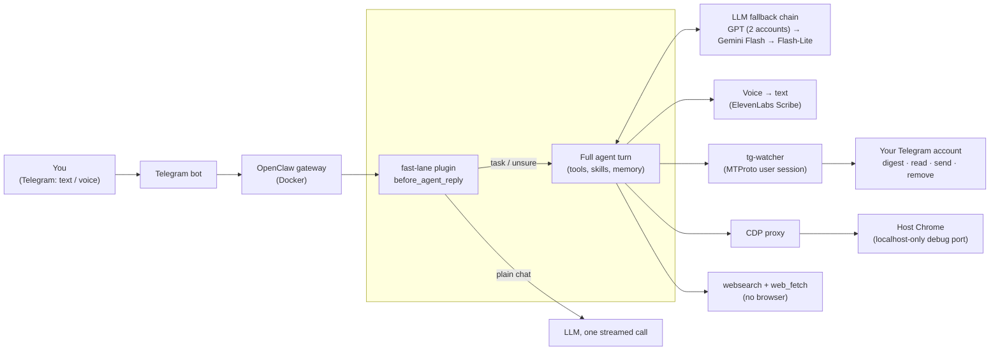
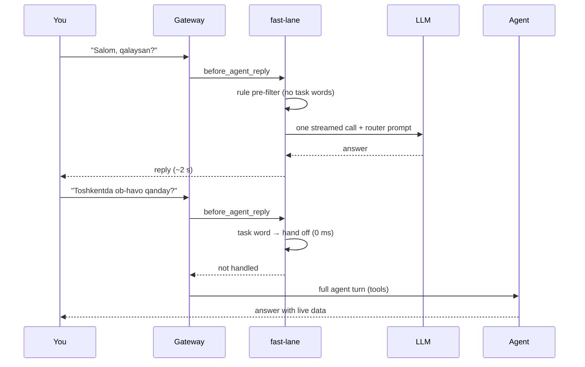

<p align="center">
  
</p>

<p align="center">
  <b>A self-hosted AI assistant that lives in Telegram and actually does the work:</b><br>
  reads and summarizes your chats, writes to people from your own account, searches the web,
  and drives a real Chrome browser, with plain chat answered in about 2 seconds.
</p>

<p align="center">
  
  
  
  
  
</p>

<p align="center">
  
</p>

---

## Contents

[Why](#why) · [What it does](#what-it-does) · [Architecture](#architecture) ·
[Performance](#performance-measured-not-guessed) · [Safety](#safety-by-design) ·
[Quick start](#quick-start) · [Repository layout](#repository-layout) ·
[Limitations](#limitations-and-what-id-fix-next)

## Why

Most of a busy day goes into the same loop: switch to Telegram, scroll through chats,
open the browser, copy, paste, reply. Off-the-shelf chatbots *answer questions*; they don't
act inside your accounts.

**ClawAI is an agent that acts.** You send one message in Telegram ("what's new in my
chats?", "find X and send it to Y", "leave these channels"), and it plans the steps, uses
your own Telegram account and your logged-in browser, and reports back in plain language.

It is built on the open-source [OpenClaw](https://github.com/openclaw/openclaw) agent
gateway. This repository is my deployment and everything I built around it: the Docker
stack, custom CLIs and skills, a speed-focused plugin, agent instructions, setup scripts
and tests.

## What it does

| You say (in Telegram, text or voice) | What happens | Typical time |
|---|---|---|
| "Salom, qalaysan?" / any small talk or explanation | Answered directly by the **fast lane** (no agent setup) | **~2 s** |
| "What's new in my Telegram?" | One `tg-send digest` call over your own account: people, groups, optional channels | ~14 s |
| "Read my chat with Ali" / "Find the marketing group" | Reads or resolves chats from your account with a warmed dialog cache | one step |
| "Write to Ali: I'll be 10 minutes late" | Sends from **your** account; ambiguous names → asks which one | one step |
| "Weather in Tashkent" / "Find the best price for X" | Browserless web search (`websearch`) + `web_fetch` | ~19 s |
| "Log in to the site and download the report" | Drives the host Chrome through the DevTools Protocol | depends on site |
| "Clean up my Telegram: leave these channels" | **Dry run first**, numbered list, then executes only after an explicit "yes" | one step + confirm |
| Voice note | Transcribed (ElevenLabs Scribe), then handled like text | + transcription |

Extras included in the repo: Google Workspace skills (Gmail, Calendar, Drive, Sheets, Docs,
Tasks via the `gws` CLI), a delegated-conversation mode (`proxy-chat`), keyword-triggered
meeting and task capture from your outgoing DMs, and forum-topic intelligence for groups.

## Architecture



**Request lifecycle.** The fast lane runs *before* OpenClaw prepares an agent turn, so plain
conversation never pays the 5–7 s setup cost:



**Main pieces**

| Component | Role |
|---|---|
| `workspace/plugins/fast-lane/` | `before_agent_reply` hook: regex pre-filter → one model call with a strict router prompt (`AGENT` = hand off). 7 s timeout, second-account fallback, per-turn log. |
| `workspace/bin/tg-send` | My CLI over the tg-watcher HTTP API: `digest`, `messages`, `resolve`, `send`, `list`, `remove` (dry run by default). |
| `tg-watcher` (`workspace/skills/meeting-scanner/scripts/tg-watcher.js`) | Long-running MTProto (gramJS) client on loopback: dialog cache, send-as-owner, forum topics, safe chat removal, keyword triggers. |
| `workspace/bin/websearch` | DuckDuckGo HTML search, ~2 s, no browser. |
| `workspace/bin/cdp-host-proxy.js` + `cdp-proxy` service | Lets the container reach host Chrome while Chrome stays bound to localhost. |
| `workspace/AGENTS.md` | Agent operating rules: speed-first, fast paths, a self-maintained **Learned Fast Paths** table (skill memory), safety and hard stops. |

## Performance: measured, not guessed

I profiled the system twice and fixed what the measurements showed.

**Round 2 (Nov 2026).** Same three prompts in fresh sessions, timed end to end through the
gateway CLI (which itself adds ~2 s):

| Task | Before | After |
|---|---|---|
| Plain chat ("Hi, how are you?") | 19.7 s | **4.2 s** (≈2 s inside the bot) |
| Web lookup (weather) | 28.0 s | **19.4 s** |
| "What's new in my Telegram?" | 57.3 s | **13.9 s** |
| Prompt sent per message | 40k tokens | **23.6k tokens** |

**Round 1 (earlier).** Measured on real Telegram tasks:

| Task | Before | After |
|---|---|---|
| Google search through the browser | 175 s | **37 s** |
| Web lookup (new `websearch`, no browser) | 37 s | ~18 s |
| "What's new in my Telegram?" | 38 s | ~20 s |
| Gateway start-up | 21.9 s | 9.3 s |

**Round 1 changes:** found hung Chrome tabs that made every page snapshot time out (enabled tab
clean-up); trimmed 71 → 21 skills and 17 → 6 plugins; replaced per-message re-reading of
instruction files; added browserless web search; tuned compaction after finding a 52k-token
history causing 27 s turns; moved SQLite state into Docker volumes.

**Round 2 changes:**
- **Prompt diet.** 26 unused tool schemas denied (78k → 51k chars); `AGENTS.md`
  21k → 7k chars; long-term memory 29k → 1.6k chars (history archived, not deleted).
- **The real bottleneck was not the model.** The model answered in ~2.3 s, but each turn spent
  5–9 s in agent preparation. A CPU profile of the live gateway (Node inspector) showed the
  main thread in synchronous `lstat`/`stat` calls over the Windows 9p bind mount
  (~1.5 ms each, ~270× slower than ext4). The workspace now lives in a Docker volume.
- **Fast lane plugin** for plain conversation (see above).
- **Upgrade** OpenClaw 2026.9.8 → 2026.11 with full volume backups, a rollback image tag
  and a doctor-driven database migration (schema v24 → v27).

Method, raw findings and trade-offs: [`docs/PERFORMANCE.md`](docs/PERFORMANCE.md).

## Safety by design

The assistant acts with the owner's real accounts, so the guardrails live in code, not only
in the prompt.

- **Irreversible actions need two steps.** `tg-send remove` is a dry run by default, max 30
  chats per call; the agent must show the numbered list and get a *new* explicit "yes".
  Saved Messages and the assistant's own bot are blocked in code. Every removal is
  written to an audit log.
- **Hard stops** in the agent rules: no money movement, no secret disclosure, no destructive
  system actions, nothing illegal.
- **Owner lock.** Only the owner's Telegram ID can command the bot
  (`scripts/lock-owner.*`).
- **Browser stays local.** Chrome's debug port is bound to localhost; the container reaches
  it through a small proxy.
- **No secrets in the repo.** `.env`, Telegram sessions, OAuth files, chat history, memory and
  runtime state are excluded; IDs are placeholders. Every push is scanned first.
- **Fast lane is conservative.** Anything that looks like a task, needs live data or touches
  accounts goes to the full agent; errors and timeouts fall back to the agent too.

## Quick start

**Prerequisites:** Docker Desktop (or Docker Engine + Compose), Google Chrome on the host,
a Telegram bot token from [@BotFather](https://t.me/BotFather), Telegram API ID/hash from
[my.telegram.org](https://my.telegram.org), and an OpenAI-compatible model API key.

```bash
git clone https://github.com/artikovozodbek/openclaw-telegram-assistant.git
cd openclaw-telegram-assistant

cp .env.example .env                                   # fill in your keys
cp config/openclaw.json.example config/openclaw.json   # set your Telegram user ID

./scripts/mtproto-setup.sh        # one-time: log in your Telegram user session (QR)
docker compose --profile mtproto up -d openclaw-gateway cdp-proxy openclaw-cli tg-watcher
```

For browser tasks, start Chrome with a localhost-only debug port:
`scripts/start-cdp.ps1` (Windows) or `scripts/start-cdp.sh` (macOS/Linux).
Then message your bot in Telegram. Full notes: [`docs/SETUP.md`](docs/SETUP.md).

**Run the tests**

```bash
node --test $(find . -name "*.test.*" -not -path "*/node_modules/*")   # 69 tests
```

## Repository layout

| Path | What |
|---|---|
| `docker-compose.yml` | Gateway, CLI, CDP proxy, tg-watcher and realtime services; state in named volumes |
| `config/openclaw.json.example` | Models and fallback chain, Telegram channel, tool deny-list, fast-lane plugin |
| `workspace/AGENTS.md`, `SOUL.md`, `POLICY.md` | Agent rules, persona, safety policy |
| `workspace/plugins/fast-lane/` | Quick-reply plugin |
| `workspace/bin/` | `tg-send`, `websearch`, CDP proxy, Google Workspace CLI wrappers |
| `workspace/skills/` | Telegram, proxy chat, meeting/task scanners, topic intelligence, Google Workspace, PM |
| `scripts/` | Setup, Chrome CDP launcher, MTProto login, owner lock, cron installers, tests |
| `docs/` | Setup notes, performance write-up, media |

## Tech stack

OpenClaw (Node.js agent gateway) · Docker Compose · Telegram Bot API · MTProto (gramJS) ·
Chrome DevTools Protocol · OpenAI-compatible Responses API · Gemini · ElevenLabs Scribe ·
DuckDuckGo HTML search · Google Workspace CLI · `node:test`

## Limitations and what I'd fix next

- **Multi-step tasks still take 14–19 s.** Most of it is sequential tool calls; the next step
  is turning frequent tasks into one-step scripts through the Learned Fast Paths table and
  running independent steps in parallel.
- **Fast-lane replies are not written to the agent transcript.** The full agent does not see
  that small talk; a follow-up should record them through the host transcript hook.
- **Single-owner design.** One owner, one Telegram account. Multi-tenant use needs one
  isolated agent per user.
- **Tested on a Windows host** with Docker Desktop; macOS/Linux scripts exist but saw less
  real use.
- **Depends on hosted models.** Without a reachable model provider the bot cannot answer;
  a local model fallback is not configured.

## Credits

Built on [OpenClaw](https://github.com/openclaw/openclaw). Vendored tools keep their own
licenses: Google Workspace CLI and Telegram MCP.

**Author:** Ozodbek Artikbayev ([@artikovozodbek](https://github.com/artikovozodbek)):
deployment, `tg-send` and the tg-watcher endpoints, `websearch`, the fast-lane plugin,
safety rules, profiling and performance work, setup scripts and tests.
