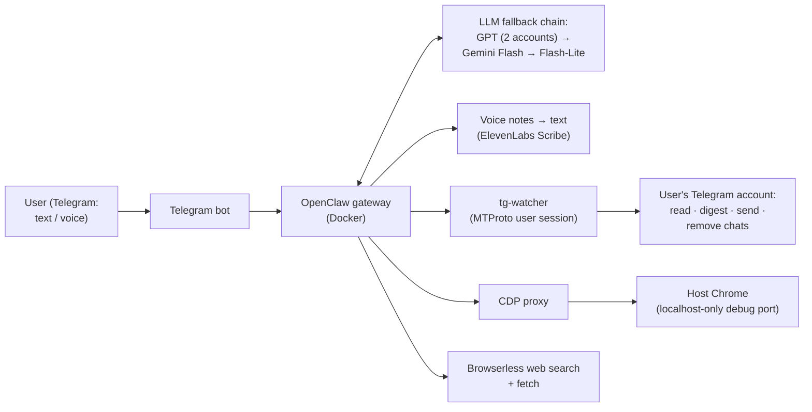

# Personal AI Assistant on Telegram + Browser (OpenClaw)

A self-hosted AI assistant you talk to **in Telegram** (text or voice). It can read and
summarize your Telegram chats, write to people from your own account, search the web,
drive a real Chrome browser, and clean up your Telegram on request.

Built on the open-source **[OpenClaw](https://github.com/openclaw)** agent gateway. This repo
holds my deployment: Docker Compose stack, custom skills, CLI tools, agent instructions and
setup scripts.

> **Not included:** `.env`, Telegram sessions, bot token, OAuth files, chat history, agent
> memory and runtime state. Telegram IDs in config and tests are placeholders.


---

## Architecture



## What I built and customized

**Telegram "fast paths": my own CLI, `tg-send`** (`workspace/bin/`)
- `digest`: what's new across people and groups in **one call (~0.8 s)**
- read a chat, find a person, send a message, each in **one step**
- `remove`: leave channels/groups, block bots, delete chats. **Dry run by default**,
  max 30 per call, private chats skipped, protected chats blocked in code, audit log.
  The assistant must show the list and get an explicit "yes" first.

**Speed work (measured)**

| Task | Before | After |
|---|---|---|
| Google search in the browser | 175 s | 37 s |
| Web lookup (no browser, `websearch`) | 37 s | ~18 s |
| "What's new in my Telegram?" | 38 s | ~20 s |
| Gateway start-up | 21.9 s | 9.3 s |

How:
- found **hung Chrome tabs** that made every page snapshot time out, and enabled automatic tab clean-up
- disabled unused skills and plugins (71 → 21 skills, 17 → 6 plugins)
- removed per-message re-reading of instruction files, added a browserless web search
- found that **huge session history** caused 27-second turns, and tuned compaction
- moved SQLite state from Windows bind mounts to Docker volumes

**Speed work, round 2 (Nov 2026): profiled, then fixed the real bottlenecks**

| Task (same test, end to end) | Before | After |
|---|---|---|
| Plain chat ("Hi, how are you?") | 19.7 s | **4.2 s** (≈2 s inside the bot) |
| Weather / web lookup | 28 s | 19.4 s |
| "What's new in my Telegram?" | 57 s | **13.9 s** |
| Prompt size per message | 40k tokens | 23.6k tokens |

What I found and changed (details in [`docs/PERFORMANCE.md`](docs/PERFORMANCE.md)):
- **Fast lane plugin** (`workspace/plugins/fast-lane/`): a `before_agent_reply` hook answers
  plain conversation with one streamed model call (~2 s) *before* the full agent turn is
  prepared; anything that needs tools, live data, Telegram, files or the browser goes to the
  agent unchanged. Rule-based pre-filter + model router (`AGENT` token), 7 s timeout,
  second-account fallback, per-turn log.
- **Prompt diet:** 26 unused tool schemas denied (78k → 51k chars), instruction file
  21k → 7k chars and long-term memory 29k → 1.6k chars (history archived, not deleted).
- **Workspace off the Windows bind mount:** CPU-profiling the gateway showed seconds of
  synchronous `lstat`/`stat` over the 9p mount (~1.5 ms per call); the workspace now lives
  in a Docker volume.
- **Skill memory:** the agent turns any repeated multi-step task into a one-step script and
  records it in a "Learned Fast Paths" table in `AGENTS.md`.
- **Upgraded OpenClaw** 2026.9.8 → 2026.11 (session/prompt-cache fixes) with full volume
  backups, image rollback tag and a doctor-driven database migration.

**Reliability**
- model fallback chain across two GPT provider accounts plus free Gemini models
- voice notes transcribed via ElevenLabs Scribe
- safe restart procedure (avoids a stale "gateway owner lease" crash loop)
- Chrome remote debugging bound to **localhost only**

## Repository layout

| Path | What |
|---|---|
| `docker-compose.yml` | Gateway, CLI, CDP proxy, tg-watcher, realtime services |
| `config/openclaw.json.example` | Gateway config: models, fallback chain, Telegram channel, tools (IDs are placeholders) |
| `workspace/AGENTS.md`, `SOUL.md`, `POLICY.md` | Agent instructions, persona and safety policy |
| `workspace/bin/` | `tg-send`, `websearch` and other fast-path CLIs |
| `workspace/skills/` | Custom skills (Telegram watcher, proxy chat, topic intelligence, …) |
| `scripts/` | Setup, Chrome CDP launcher, MTProto login, owner lock, cron installers + tests |
| `docs/SETUP.md` | Original detailed setup notes |

## Run it

```bash
cp .env.example .env          # fill in your own keys
cp config/openclaw.json.example config/openclaw.json   # set your Telegram user/group IDs
./scripts/mtproto-setup.sh    # optional: log in a Telegram user session for tg-watcher
docker compose --profile mtproto up -d --pull never openclaw-gateway cdp-proxy openclaw-cli tg-watcher
```

Browser automation needs host Chrome with a localhost-only debug port, see `scripts/start-cdp.ps1`.

## Tech stack

OpenClaw (Node.js agent gateway) · Docker Compose · Telegram Bot API · MTProto (gramJS) ·
Chrome DevTools Protocol · OpenAI-compatible LLM APIs · Gemini · ElevenLabs STT ·
DuckDuckGo HTML search
